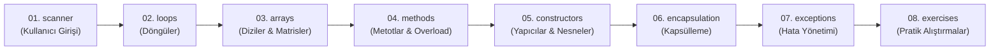

# 🚀 Java Öğrenme Rehberi ve OOP Alıştırma Kütüphanesi


Bu proje; Java dünyasına yeni adım atan geliştiricilerin ve yazılım meraklılarının **temel programlama kavramlarından**, **Nesne Yönelimli Programlamanın (OOP)** temel prensiplerine ve **İleri Hata Yönetimine (Exceptions)** kadar tüm konuları sindirerek öğrenmelerini sağlamak amacıyla hazırlanmış **açık kaynaklı, öğretici ve modüler** bir kaynaktır.

Kodların tamamı temiz kod (Clean Code) standartlarına uygun, Türkçe açıklamalı ve JavaDoc dokümantasyonlarıyla zenginleştirilmiştir.

---

## 📌 İçindekiler
- [🎯 Projenin Amacı](#-projenin-amacı)
- [🗺️ Öğrenme Yol Haritası (Roadmap)](#️-öğrenme-yol-haritası-roadmap)
- [📂 Paket Yapısı ve Konular](#-paket-yapısı-ve-konular)
- [🧩 Alıştırmalar & Çözüm Kataloğu (Easy - Medium - Hard)](#-alıştırmalar--çözüm-kataloğu)
- [⚡ Projeyi Çalıştırma](#-projeyi-çalıştırma)
- [💻 Konsol Gezgini (Main Giriş Noktası)](#-konsol-gezgini-main-giriş-noktası)
- [🤝 Katkıda Bulunma](#-katkıda-bulunma)

---

## 🎯 Projenin Amacı

Java öğrenirken sadece teorik açıklamalar okumak yerine;
1. **Çalışan gerçek kod örneklerini** incelemek,
2. Karşılaşılabilecek en yaygın tuzakları (örneğin Scanner buffer sorunu, exception yönetimi, pass-by-value) görmek,
3. **Basitten zora (3 Kolay, 3 Orta, 2 Zor)** özenle kurgulanmış problemleri çözümleriyle birlikte test ederek algoritmik ve nesne yönelimli düşünme kabiliyetini geliştirmek.

---

## 🗺️ Öğrenme Yol Haritası (Roadmap)

Projeyi aşağıdaki pedagojik sırayla incelemeniz tavsiye edilir:



---

## 📂 Paket Yapısı ve Konular

| Paket | İçerik & Sınıflar | Öğretilen Temel Kavramlar |
| :--- | :--- | :--- |
| **`scanner`** | [`ScannerBasics.java`](file:///src/scanner/ScannerBasics.java)<br>[`MadLibsGame.java`](file:///src/scanner/MadLibsGame.java) | Konsoldan girdi alma (`nextInt`, `nextDouble`, `nextLine`), Scanner Buffer/Enter atlama sorununun çözümü, pratik kelime oyunu. |
| **`loops`** | [`LoopsBasics.java`](file:///src/loops/LoopsBasics.java)<br>[`LoopsWithIfElse.java`](file:///src/loops/LoopsWithIfElse.java) | `for`, `while`, `do-while`, `for-each`, lineer arama (search); **Döngülerde `if-else` kullanımı**: tek/çift ayrıştırma, pozitif/negatif toplama, kademeli not baremi analizi, kalan hak/güvenlik kontrolü (`break`), sepette kademeli indirim hesaplama. |
| **`arrays`** | [`ArraysBasics.java`](file:///src/arrays/ArraysBasics.java) | Tek boyutlu diziler, 2D matrisler, dizi arama/sıralama, `Arrays.sort()`, `Arrays.binarySearch()`, `Arrays.toString()`. |
| **`methods`** | [`MethodsBasics.java`](file:///src/methods/MethodsBasics.java) | `void` vs değer döndüren metotlar, parametre aktarımı, static vs instance metot farkı, metot aşırı yükleme (**Method Overloading**), **Varargs** (`int...`). |
| **`constructors`**| [`Person.java`](file:///src/constructors/Person.java)<br>[`Department.java`](file:///src/constructors/Department.java)<br>[`ConstructorsBasics.java`](file:///src/constructors/ConstructorsBasics.java) | Parametresiz (default) ve parametreli yapıcılar, `this` anahtar kelimesi, `this(...)` ile **Constructor Chaining**, nesne ilişkileri (Association). |
| **`encapsulation`**| [`User.java`](file:///src/encapsulation/User.java)<br>[`BankAccount.java`](file:///src/encapsulation/BankAccount.java)<br>[`EncapsulationBasics.java`](file:///src/encapsulation/EncapsulationBasics.java) | Veri gizleme (**Data Hiding**), `private` alanlar, `getter`/`setter` kontrolleri, veri doğrulama (**validation**), bakiye tutarlılığı koruma. |
| **`exceptions`** | [`InvalidAgeException.java`](file:///src/exceptions/InvalidAgeException.java)<br>[`ExceptionsBasics.java`](file:///src/exceptions/ExceptionsBasics.java) | `try-catch-finally` mekanizması, çoklu catch (**multi-catch**), `throw` ve `throws` anahtar kelimeleri, **Özel Hata Sınıfları (Custom Checked Exceptions)**. |

---

## 🧩 Alıştırmalar & Çözüm Kataloğu

`src/exercises` paketi altında yer alan alıştırmalar **Kolay (3)**, **Orta (3)** ve **Zor (2)** olarak seviyelendirilmiştir. Her bir sınıf içerisinde detaylı soru metni, gereksinimler ve eksiksiz çözüm kodu yer almaktadır.

### 🟢 Kolay Seviye (Easy - 3 Örnek)
1. **[`Easy01_BMICalculator.java`](file:///src/exercises/easy/Easy01_BMICalculator.java) (Vücut Kitle İndeksi Hesaplayıcı)**
   - *Konu:* Scanner, Temel Matematik, `if-else-if`
   - *Açıklama:* Kullanıcıdan alınan boy ve kilo ile VKİ formülünü hesaplar; Zayıf, Normal, Fazla Kilolu, Obez durumunu belirler.
2. **[`Easy02_PalindromeChecker.java`](file:///src/exercises/easy/Easy02_PalindromeChecker.java) (Palindrom Kelime / Sayı Denetleyici)**
   - *Konu:* Döngüler (Loops), String Analizi, İki İşaretçi (Two-Pointers) Tekniği
   - *Açıklama:* Verilen kelimenin ("kayak", "radar" vb.) düzden ve tersten okunuşunun eşitliğini döngüyle kontrol eder.
3. **[`Easy03_ArrayMinMaxAvg.java`](file:///src/exercises/easy/Easy03_ArrayMinMaxAvg.java) (Dizide Min, Max ve Aritmetik Ortalama)**
   - *Konu:* Diziler, `for-each`, İstatistiksel Hesaplama
   - *Açıklama:* Bir tamsayı dizisini tek geçişte inceleyerek en büyük, en küçük elemanı, toplamı ve ortalamayı raporlar.

### 🟡 Orta Seviye (Medium - 3 Örnek)
1. **[`Medium01_FrequencyCounter.java`](file:///src/exercises/medium/Medium01_FrequencyCounter.java) (Eleman Tekrar Sayısı / Frekans)**
   - *Konu:* Diziler, İç İçe Döngüler, Bayrak Dizisi (Visited Array)
   - *Açıklama:* Bir dizideki tüm sayıların kaçar kez tekrarlandığını hesaplar; aynı elemanı tekrar tekrar yazdırmadan temiz bir özet sunar.
2. **[`Medium02_GradeManager.java`](file:///src/exercises/medium/Medium02_GradeManager.java) (Öğrenci Not & Başarı Sistemi)**
   - *Konu:* Metotlar, Metot Aşırı Yükleme (Overloading), Karar Mantığı
   - *Açıklama:* Hem 2 sınavlı (Vize-Final) hem 3 sınavlı (Vize-Proje-Final) derslerin ağırlıklı ortalamasını, harf notunu (AA-FF) ve sınıf genel başarı istatistiğini üretir.
3. **[`Medium03_BankAccountApp.java`](file:///src/exercises/medium/Medium03_BankAccountApp.java) (Güvenli Banka Hesabı & Günlük Limit)**
   - *Konu:* Kapsülleme (Encapsulation), Durum Yönetimi, İş Kuralları
   - *Açıklama:* Negatif para yatırmayı engelleyen, yetersiz bakiyede izin vermeyen ve günlük çekim limitini (Daily Limit) adım adım takip eden güvenli bankacılık nesnesi.

### 🔴 Zor Seviye (Hard - 2 Örnek)
1. **[`Hard01_CompanyDepartmentSystem.java`](file:///src/exercises/hard/Hard01_CompanyDepartmentSystem.java) (Kurumsal Şirket, Departman & Personel Yönetimi)**
   - *Konu:* Çok Katmanlı OOP (Company $\rightarrow$ Department $\rightarrow$ Employee), Listeler, Filtreleme, Zam ve İstatistik Raporlama
   - *Açıklama:* Departmanlara personel atama, en başarılı çalışanı (Top Performer) bulma, departman bazında yüzdesel zam uygulama ve genel şirket mali tablosunu çıkaran kapsamlı sistem.
2. **[`Hard02_UserAuthSystem.java`](file:///src/exercises/hard/Hard02_UserAuthSystem.java) (Güvenli Kimlik Doğrulama & Özel Hata Yönetimi)**
   - *Konu:* Custom Exception Hiyerarşisi (`WeakPasswordException`, `InvalidEmailException`, `UserAlreadyExistsException`, `AuthenticationFailedException`), `throw/throws`, String Validasyonları
   - *Açıklama:* Kurumsal kullanıcı kayıt ve oturum açma motoru. Parolanın büyük harf, küçük harf, rakam ve asgari uzunluk kurallarını özel istisnalarla güvenli şekilde denetler.

---

## ⚡ Projeyi Çalıştırma

### Yöntem 1: IntelliJ IDEA veya Eclipse / VS Code ile
1. Projeyi bir Java projesi olarak IDE'nizde açın.
2. `src/Main.java` dosyasını açıp sağ tıklayarak **Run 'Main'** seçeneğini çalıştırın.

### Yöntem 2: Terminal / Komut Satırı ile
Proje kök dizinindeyken:

```bash
# 1. Kaynak kodları derleme
javac -d out/production/oop-quiz $(find src -name "*.java")

# 2. Ana İnteraktif Menüyü Çalıştırma
java -cp out/production/oop-quiz Main
```

---

## 💻 Konsol Gezgini (Main Giriş Noktası)

Projenin merkezinde yer alan [`src/Main.java`](file:///src/Main.java) sınıfını çalıştırdığınızda sizi interaktif bir terminal menüsü karşılar. İstediğiniz konuyu veya alıştırmayı tek bir tuşla anında çalıştırıp test edebilirsiniz:

```text
========================================================
   JAVA ÖĞRENME REHBERİ & ALIŞTIRMA MERKEZİ
========================================================
--- [TEMEL KONU ANLATIMLARI] ---
 1 - Loops Basics (Döngüler: for, while, do-while, for-each, arama)
 2 - Loops + If-Else (Döngü & Karar Yapıları: Tek/Çift, Not Baremi, Kalan Hak, Sepet)
 3 - Arrays (Diziler, 2D Matrisler ve Arrays Sınıfı)
 4 - Methods (Metotlar, Overloading ve Varargs)
 5 - Constructors (Yapıcılar, 'this', Nesne İlişkileri)
 6 - Encapsulation (Kapsülleme, Data Hiding, Validation)
 7 - Exceptions (Hata Yakalama, Custom Exceptions)

--- [KOLAY SEVİYE ALIŞTIRMALAR] ---
 8 - [Kolay 1] Vücut Kitle İndeksi (VKİ) Hesaplayıcı
 9 - [Kolay 2] Palindrom Kelime/Sayı Denetleyici
10 - [Kolay 3] Dizide Min, Max ve Ortalama Bulucu

--- [ORTA SEVİYE ALIŞTIRMALAR] ---
11 - [Orta 1] Dizide Eleman Frekansı / Tekrar Sayısı
12 - [Orta 2] Öğrenci Not & Başarı Sistemi (Overloading)
13 - [Orta 3] Banka Hesabı & Günlük Limit Simülasyonu

--- [ZOR SEVİYE ALIŞTIRMALAR] ---
14 - [Zor 1] Kurumsal Şirket, Departman & Personel Sistemi
15 - [Zor 2] Güvenli Kullanıcı Kayıt & Custom Exception Sistemi

 0 - Çıkış
========================================================
```

---

## 🤝 Katkıda Bulunma

1. Bu depoyu Fork'layın (`Fork`).
2. Yeni bir özellik veya alıştırma dalı oluşturun (`git checkout -b feature/YeniKonu`).
3. Değişikliklerinizi commit edin (`git commit -m 'feat: Yeni alıştırma eklendi'`).
4. Dalınıza push yapın (`git push origin feature/YeniKonu`).
5. Bir **Pull Request** açın.

---
⭐ Projeyi beğendiyseniz GitHub üzerinde yıldız (**Star**) vermeyi unutmayın!
